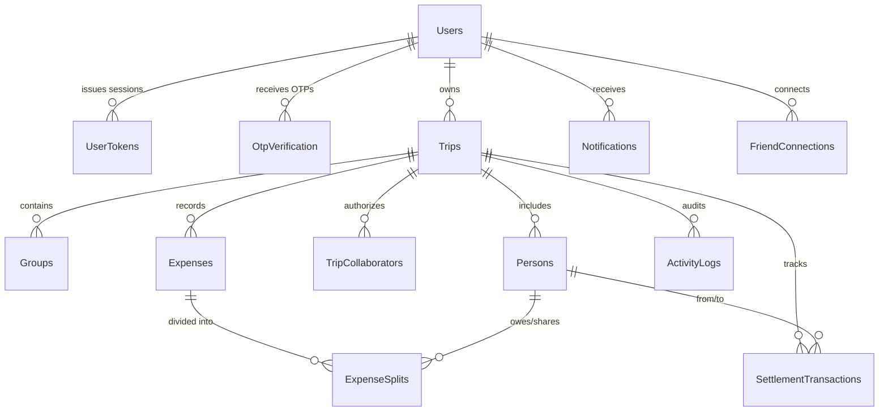

# API Test Inventory & Database Mapping (1,000-User Simulation)

**Project:** Trip Distribution API (.NET 9.0 + SQL Server)  
**Database:** `SPLIT_BILL_DB`  
**Host Target:** `http://localhost:5262`  
**Target Solution:** `C:\My_Project\TRIP_DISTRIBUTION_API\TripDistribution.sln`  
**Total Discovered Endpoints:** 54 across 10 Controllers  
**Total Database Tables Mapped:** 13

---

## 1. Authentication & Identity Workflows (`/api/Auth`)
**Base Route:** `/api/Auth`  
**Class Level Auth:** `[Authorize]` (Requires Bearer token unless marked `[AllowAnonymous]`)  
**Backing Services:** `IAuthDataService`, `IJwtTokenService`, `IPasswordHasher`, `IEmailService`, `IUserDataService`

### Endpoint Inventory
| # | Verb & Route | Action | Auth Level | Required Parameters & Body DTO | Expected Database Effects |
|---|---|---|---|---|---|
| 1 | `POST /api/Auth/register` | `Register` | `[AllowAnonymous]` | **Body:** `RegisterRequestDto` - `fullName` (string) - `username` (string) - `email` (string, valid email) - `phone` (string, min 10 digits) - `password` (string, min 6 chars) - `dietType` (int: 1=Veg, 2=NonVeg, etc.) - `dietName` (optional) - `avatarColor` (optional) - `deviceInfo` (optional) | **INSERT** into `Users` - Generates `user_id` (GUID) - Computes `password_hash` (PBKDF2) **INSERT** into `OtpVerification` - `otp_code` (cryptographic 6-digit) - `expires_at` (10 min) **INSERT** into `UserTokens` - `auth_token` (JWT with unique `jti`) - `is_active = 1` |
| 2 | `POST /api/Auth/login` | `Login` | `[AllowAnonymous]` | **Body:** `LoginRequestDto` - `email` or `phone` or `username` or `userId` - `password` (string) - `deviceInfo` (optional) | **SELECT** from `Users` **UPDATE** `Users SET last_login_at = GETDATE()` **UPDATE** `UserTokens SET is_active = 0 WHERE user_id = @UserId` (single-session rotation) **INSERT** into `UserTokens` (new session record) |
| 3 | `POST /api/Auth/biometric-login` | `BiometricLogin` | `[AllowAnonymous]` | **Body:** `BiometricLoginDto` - `userId` (string GUID) - `authToken` (active session token) - `deviceInfo` (optional) | **SELECT** from `UserTokens` **UPDATE** `UserTokens SET is_active = 0 WHERE auth_token = @AuthToken` **INSERT** into `UserTokens` (rotated session token) **UPDATE** `Users SET last_login_at = GETDATE()` |
| 4 | `POST /api/Auth/send-otp` | `SendOtp` | `[Authorize]` | **Headers:** `Authorization: Bearer <token>` **Body:** `SendOtpDto` - `userId` (optional, must match authenticated user) - `purpose` ("LOGIN", "VERIFY", "REGISTER") - `email` / `phone` (optional) | **SELECT** from `Users` **INSERT** into `OtpVerification` - `otp_code` generated and dispatched via SMTP/logs |
| 5 | `POST /api/Auth/verify-otp` | `VerifyOtp` | `[Authorize]` | **Headers:** `Authorization: Bearer <token>` **Body:** `VerifyOtpDto` - `otpCode` (string, 6 digits) - `purpose` (string) - `userId` (must match authenticated user) | **UPDATE** `OtpVerification SET is_verified = 1` (atomic CTE check-and-update) **UPDATE** `Users SET is_active = 1, updated_at = GETDATE()` |
| 6 | `POST /api/Auth/reset-password` | `ResetPassword` | `[Authorize]` | **Headers:** `Authorization: Bearer <token>` **Body:** `ResetPasswordDto` - `phone` (string) - `otpCode` (string) - `newPassword` (min 6 chars) | **SELECT & UPDATE** `OtpVerification` **UPDATE** `Users SET password_hash = @NewHash, updated_at = GETDATE()` |
| 7 | `GET /api/Auth/profile` | `GetProfile` | `[Authorize]` | **Headers:** `Authorization: Bearer <token>` | **SELECT** from `Users WHERE user_id = @AuthUserId` |
| 8 | `PUT /api/Auth/profile` | `UpdateProfile` | `[Authorize]` | **Headers:** `Authorization: Bearer <token>` **Body:** `UpdateProfileDto` - `fullName`, `avatarColor`, `dietType`, `dietName` | **UPDATE** `Users SET full_name = @FullName, avatar_color = @Color, diet_type = @Diet, updated_at = GETDATE()` |
| 9 | `PUT /api/Auth/diet` | `UpdateDiet` | `[Authorize]` | **Headers:** `Authorization: Bearer <token>` **Body:** `UpdateDietDto` - `dietType` (int), `dietName` (string) | **UPDATE** `Users SET diet_type = @Diet, diet_name = @DietName, updated_at = GETDATE()` |
| 10 | `POST /api/Auth/verify-token` | `VerifyToken` | `[Authorize]` | **Headers:** `Authorization: Bearer <token>` **Body:** `VerifyTokenDto` - `token` (string) | **SELECT** from `UserTokens` and `Users` (verifies expiry and active state) |
| 11 | `POST /api/Auth/logout` | `Logout` | `[Authorize]` | **Headers:** `Authorization: Bearer <token>` | **UPDATE** `UserTokens SET is_active = 0 WHERE auth_token = @RawToken` |

---

## 2. Trips Management (`/api/Trips`)
**Base Route:** `/api/Trips`  
**Class Level Auth:** `[Authorize]`  
**Backing Service:** `ITripDataService`

| # | Verb & Route | Action | Required Parameters & Body DTO | Expected Database Effects |
|---|---|---|---|---|
| 12 | `GET /api/Trips` | `GetMyTrips` | **Headers:** `Authorization: Bearer <token>` | **SELECT** CTE aggregation from `Trips`, `Persons`, `TripCollaborators`, `Expenses` for current `user_id` |
| 13 | `GET /api/Trips/{id}` | `GetTripById` | **Path:** `id` (Trip GUID) **Headers:** `Authorization: Bearer <token>` | BOLA Check: `HasUserTripAccessAsync` **SELECT** from `Trips`, `Groups`, `Persons`, `Expenses`, `ExpenseSplits`, `SettlementTransactions` |
| 14 | `POST /api/Trips` | `CreateTrip` | **Headers:** `Authorization: Bearer <token>` **Body:** `CreateTripDto` - `name` (required, 1-100 chars) - `description` (optional, max 500 chars) - `currencyCode` (default "INR") | **ACID Transaction:** 1. **INSERT** into `Trips` 2. **INSERT** into `Groups` (Default 'General' group) 3. **INSERT** into `Persons` (Creator as member) 4. **INSERT** into `TripCollaborators` (Creator as 'OWNER') 5. **INSERT** into `ActivityLogs` ('CREATE_TRIP') |
| 15 | `POST /api/Trips/sync` | `SyncTrips` | **Headers:** `Authorization: Bearer <token>` **Body:** `SyncTripsDto` - `trips` (array of trip objects) | **Bulk Transaction:** UPSERT trips for authenticated user |
| 16 | `PUT /api/Trips/{id}` | `UpdateTrip` | **Path:** `id` (Trip GUID) **Body:** `UpdateTripDto` - `name` (1-100 chars), `description` (max 500 chars) | BOLA Check: `CanUserManageTripAsync` **UPDATE** `Trips SET name = @Name, description = @Desc, updated_at = GETDATE()` **INSERT** into `ActivityLogs` ('UPDATE_TRIP') |
| 17 | `DELETE /api/Trips/{id}` | `DeleteTrip` | **Path:** `id` (Trip GUID) | BOLA Check: `IsTripOwnerAsync` **CASCADE DELETE:** Deletes from `ExpenseSplits`, `Expenses`, `SettlementTransactions`, `Persons`, `Groups`, `TripCollaborators`, `ActivityLogs`, and `Trips` |

---

## 3. Expenses & Splits (`/api/Expenses`)
**Base Route:** `/api/Expenses`  
**Class Level Auth:** `[Authorize]`  
**Backing Service:** `IExpenseDataService`, `ITripDataService`

| # | Verb & Route | Action | Required Parameters & Body DTO | Expected Database Effects |
|---|---|---|---|---|
| 18 | `GET /api/Expenses/trip/{tripId}` | `GetExpensesByTrip` | **Path:** `tripId` (Trip GUID) | BOLA Check: `HasUserTripAccessAsync` **SELECT** from `Expenses`, `ExpenseSplits`, and `Persons` |
| 19 | `GET /api/Expenses/{id}` | `GetExpenseById` | **Path:** `id` (Expense GUID) | BOLA Check on parent Trip **SELECT** from `Expenses` joined with `ExpenseSplits` |
| 20 | `POST /api/Expenses` | `CreateExpense` | **Body:** `CreateExpenseDto` - `tripId` (GUID) - `paidByPersonId` (GUID) - `description` (1-200 chars) - `amount` (decimal > 0) - `categoryIndex`, `categoryName` - `splitType` (e.g. EQUAL, EXACT, DIETARY) - `splits` (array of `personId`, `amount`) | BOLA Check: `HasUserTripAccessAsync` Validation: `SUM(splits.amount) == amount` **ACID Transaction:** 1. **INSERT** into `Expenses` 2. **INSERT** batch into `ExpenseSplits` 3. **UPDATE** `Persons` balance adjustments (`paid_amount`, `owed_amount`, `balance`) 4. **INSERT** into `ActivityLogs` ('ADD_EXPENSE') |
| 21 | `PUT /api/Expenses/{id}` | `UpdateExpense` | **Path:** `id` (Expense GUID) **Body:** `UpdateExpenseDto` | BOLA Check on parent Trip **ACID Transaction:** 1. Revert previous balances for old splits 2. **UPDATE** `Expenses` 3. **DELETE** old `ExpenseSplits` 4. **INSERT** new `ExpenseSplits` 5. Apply new balance adjustments to `Persons` 6. **INSERT** into `ActivityLogs` ('UPDATE_EXPENSE') |
| 22 | `DELETE /api/Expenses/{id}` | `DeleteExpense` | **Path:** `id` (Expense GUID) | BOLA Check on parent Trip **ACID Transaction:** 1. Revert member balances 2. **DELETE** from `ExpenseSplits` 3. **DELETE** from `Expenses` 4. **INSERT** into `ActivityLogs` ('DELETE_EXPENSE') |
| 23 | `POST /api/Expenses/calculate-dietary-split/{tripId}` | `CalculateDietarySplit` | **Path:** `tripId` **Body:** `CalculateDietarySplitDto` - `amount` (decimal), `categoryIndex` | **SELECT** `Persons` diet types for trip; computes preview split breakdown (read-only calculation) |

---

## 4. Groups Management (`/api/Groups`)
**Base Route:** `/api/Groups`  
**Class Level Auth:** `[Authorize]`

| # | Verb & Route | Action | Required Parameters & Body DTO | Expected Database Effects |
|---|---|---|---|---|
| 24 | `GET /api/Groups/trip/{tripId}` | `GetGroupsByTrip` | **Path:** `tripId` | BOLA Check: `HasUserTripAccessAsync` **SELECT** from `Groups` |
| 25 | `POST /api/Groups` | `CreateGroup` | **Body:** `CreateGroupDto` - `tripId` (GUID), `name` (string) | BOLA Check: `CanUserManageTripAsync` **INSERT** into `Groups` **INSERT** into `ActivityLogs` ('CREATE_GROUP') |
| 26 | `PUT /api/Groups/{id}` | `UpdateGroup` | **Path:** `id` **Body:** `UpdateGroupDto` (`name`) | BOLA Check: `CanUserManageTripAsync` **UPDATE** `Groups SET name = @Name` |
| 27 | `DELETE /api/Groups/{id}` | `DeleteGroup` | **Path:** `id` | BOLA Check: `CanUserManageTripAsync` Validation: Verifies group has zero assigned members **DELETE** from `Groups` |

---

## 5. Persons & Members (`/api/Persons`)
**Base Route:** `/api/Persons`  
**Class Level Auth:** `[Authorize]`

| # | Verb & Route | Action | Required Parameters & Body DTO | Expected Database Effects |
|---|---|---|---|---|
| 28 | `GET /api/Persons/trip/{tripId}` | `GetPersonsByTrip` | **Path:** `tripId` | BOLA Check: `HasUserTripAccessAsync` **SELECT** from `Persons` |
| 29 | `GET /api/Persons/{id}` | `GetPersonById` | **Path:** `id` | BOLA Check on parent Trip **SELECT** from `Persons` |
| 30 | `POST /api/Persons` | `CreatePerson` | **Body:** `CreatePersonDto` - `tripId`, `groupId`, `name`, `phone`, `dietType`, `dietName` | BOLA Check: `CanUserManageTripAsync` **INSERT** into `Persons` **INSERT** into `ActivityLogs` ('ADD_PERSON') |
| 31 | `PUT /api/Persons/{id}` | `UpdatePerson` | **Path:** `id` **Body:** `UpdatePersonDto` | BOLA Check: `CanUserManageTripAsync` **UPDATE** `Persons SET name = @Name, phone_number = @Phone, diet_type = @Diet, diet_name = @DietName` |
| 32 | `DELETE /api/Persons/{id}` | `DeletePerson` | **Path:** `id` | BOLA Check: `CanUserManageTripAsync` Validation: Ensures person has `balance == 0.00` and no expenses **DELETE** from `Persons` |
| 33 | `POST /api/Persons/recalculate/{tripId}` | `RecalculateTrip` | **Path:** `tripId` | BOLA Check: `CanUserManageTripAsync` **ACID Balance Recomputation:** Recalculates all member `paid_amount`, `owed_amount`, and `balance` from `Expenses`, `ExpenseSplits`, and `SettlementTransactions` |

---

## 6. Debt Settlements (`/api/Settlements`)
**Base Route:** `/api/Settlements`  
**Class Level Auth:** `[Authorize]`

| # | Verb & Route | Action | Required Parameters & Body DTO | Expected Database Effects |
|---|---|---|---|---|
| 34 | `GET /api/Settlements/trip/{tripId}` | `GetSettlementsByTrip` | **Path:** `tripId` | BOLA Check: `HasUserTripAccessAsync` **SELECT** from `SettlementTransactions` |
| 35 | `GET /api/Settlements/{id}` | `GetSettlementById` | **Path:** `id` | BOLA Check on parent Trip **SELECT** from `SettlementTransactions` |
| 36 | `POST /api/Settlements` | `ProposeSettlement` | **Body:** `ProposeSettlementDto` - `tripId`, `fromPersonId`, `toPersonId`, `amount` (> 0) | BOLA Check: `HasUserTripAccessAsync` Validation: `fromPersonId != toPersonId` **INSERT** into `SettlementTransactions` (Status: 'ACCEPTED', `is_completed = 1`) **UPDATE** member balances via recalculation **INSERT** into `Notifications` & `ActivityLogs` |
| 37 | `PUT /api/Settlements/{id}/status` | `UpdateSettlementStatus` | **Path:** `id` **Body:** `UpdateSettlementStatusDto` (`status`) | BOLA Check: `HasUserTripAccessAsync` **UPDATE** `SettlementTransactions SET status = @Status, is_completed = @IsCompleted` **UPDATE** recalculates balances across members in `Persons` |
| 38 | `DELETE /api/Settlements/{id}` | `DeleteSettlement` | **Path:** `id` | BOLA Check: `HasUserTripAccessAsync` **DELETE** from `SettlementTransactions` **UPDATE** recalculates balances |

---

## 7. Friends & Contacts (`/api/Friends`)
**Base Route:** `/api/Friends`  
**Class Level Auth:** `[Authorize]`

| # | Verb & Route | Action | Required Parameters & Body DTO | Expected Database Effects |
|---|---|---|---|---|
| 39 | `GET /api/Friends` | `GetMyFriends` | **Headers:** `Authorization: Bearer <token>` | **SELECT** from `FriendConnections` JOIN `Users` WHERE status = 'ACCEPTED' |
| 40 | `POST /api/Friends/check-contacts` | `CheckContacts` | **Body:** `CheckContactsDto` - `contacts` (array of phone strings, max 100) | **SELECT** from `Users` matching normalized phones |
| 41 | `POST /api/Friends` | `AddOrInviteFriend` | **Body:** `FriendInviteDto` - `friendPhone`, `friendName`, `dietType` | **INSERT** into `FriendConnections` (status = 'PENDING') **INSERT** into `Notifications` |
| 42 | `POST /api/Friends/search` | `SearchUsers` | **Body:** `SearchFriendsDto` - `query` (phone/username) | **SELECT** from `Users` matching query |
| 43 | `GET /api/Friends/requests` | `GetFriendRequests` | **Query:** `type` ("incoming" / "outgoing") | **SELECT** from `FriendConnections` WHERE status = 'PENDING' |
| 44 | `PUT /api/Friends/{id}/status` | `UpdateStatus` | **Path:** `id` **Body:** `UpdateFriendStatusDto` ("ACCEPTED"/"REJECTED") | **UPDATE** `FriendConnections SET status = @Status` |
| 45 | `DELETE /api/Friends/{id}` | `DeleteFriend` | **Path:** `id` | **DELETE** from `FriendConnections` |

---

## 8. Trip Collaborators (`/api/Collaborators`)
**Base Route:** `/api/Collaborators`  
**Class Level Auth:** `[Authorize]`

| # | Verb & Route | Action | Required Parameters & Body DTO | Expected Database Effects |
|---|---|---|---|---|
| 46 | `GET /api/Collaborators/trip/{tripId}` | `GetCollaborators` | **Path:** `tripId` | BOLA Check: `HasUserTripAccessAsync` **SELECT** from `TripCollaborators` JOIN `Users` |
| 47 | `POST /api/Collaborators` | `InviteCollaborator` | **Body:** `InviteCollaboratorDto` - `tripId`, `userId` / `phoneNumber`, `role` | BOLA Check: `CanUserManageTripAsync` **INSERT** into `TripCollaborators` **INSERT** into `Notifications` & `ActivityLogs` |
| 48 | `PUT /api/Collaborators/{id}/role` | `UpdateRole` | **Path:** `id` **Body:** `UpdateCollaboratorRoleDto` (`role`: 'MEMBER'/'VIEWER') | BOLA Check: `IsTripOwnerAsync` (Only trip owner can modify roles) **UPDATE** `TripCollaborators SET role = @Role` |
| 49 | `DELETE /api/Collaborators/{id}` | `RemoveCollaborator` | **Path:** `id` | BOLA Check: `IsTripOwnerAsync` or self-removal **DELETE** from `TripCollaborators` |

---

## 9. Notifications System (`/api/Notifications`)
**Base Route:** `/api/Notifications`  
**Class Level Auth:** `[Authorize]`

| # | Verb & Route | Action | Required Parameters & Body DTO | Expected Database Effects |
|---|---|---|---|---|
| 50 | `GET /api/Notifications` | `GetMyNotifications` | **Headers:** `Authorization: Bearer <token>` | **SELECT** from `Notifications WHERE user_id = @UserId ORDER BY created_at DESC` |
| 51 | `GET /api/Notifications/unread-count` | `GetUnreadCount` | **Headers:** `Authorization: Bearer <token>` | **SELECT** `COUNT(*) FROM Notifications WHERE user_id = @UserId AND is_read = 0` |
| 52 | `POST /api/Notifications/mark-read` | `MarkRead` | **Body:** `MarkReadDto` - `notificationIds` (array of GUIDs) | **UPDATE** `Notifications SET is_read = 1 WHERE user_id = @UserId AND notification_id IN (...)` |
| 53 | `POST /api/Notifications/send` | `SendMessage` | **Body:** `SendMessageDto` - `recipientUserId`, `title`, `message` | BOLA/Recipient Check **INSERT** into `Notifications` |

---

## 10. Activity Audit Trail (`/api/ActivityLogs`)
**Base Route:** `/api/ActivityLogs`  
**Class Level Auth:** `[Authorize]`

| # | Verb & Route | Action | Required Parameters & Body DTO | Expected Database Effects |
|---|---|---|---|---|
| 54 | `GET /api/ActivityLogs/trip/{tripId}` | `GetLogsByTrip` | **Path:** `tripId` | BOLA Check: `HasUserTripAccessAsync` **SELECT** from `ActivityLogs WHERE trip_id = @TripId ORDER BY created_at DESC` |

---

## Summary of Database Tables & Foreign Key Dependencies

1. **Deletion / Cleanup Dependency Order:**
   To clean test data safely without foreign key conflicts:
   1. `ExpenseSplits`
   2. `Expenses`
   3. `SettlementTransactions`
   4. `TripCollaborators`
   5. `Persons`
   6. `Groups`
   7. `ActivityLogs`
   8. `Trips`
   9. `Notifications`
   10. `FriendConnections`
   11. `UserTokens`
   12. `OtpVerification`
   13. `Users`

